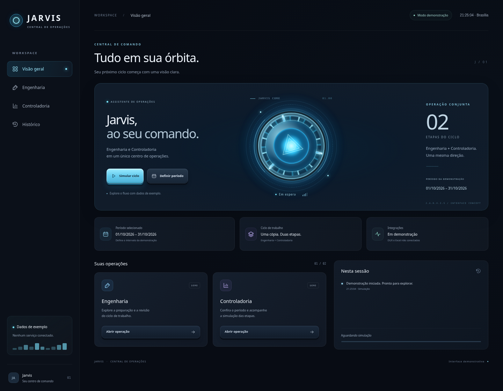

# Interface Jarvis

Interface web demonstrativa, em português, com reator luminoso central, anéis
animados, botões com relevo 3D e layout adaptável a desktop e celular.



## Abrir

Abra `interface/index.html` diretamente em um navegador atualizado, como Edge,
Chrome ou Firefox. Mantenha `styles.css` e `app.js` na mesma pasta. Não há build,
instalação de pacotes ou conexão externa para usar a interface.

Se a política do navegador bloquear arquivos locais, sirva a pasta `interface`
com um servidor estático local. Por exemplo, na raiz do repositório:

```sh
python -m http.server 8000 --bind 127.0.0.1 --directory interface
```

A abertura direta de arquivo não pôde ser validada no Chromium gerenciado deste
ambiente: sua política retornou `ERR_BLOCKED_BY_ADMINISTRATOR`. A validação
funcional foi realizada com a pasta servida por HTTP local.

Os arquivos são:

- `interface/index.html`: estrutura, ícones SVG e diálogo de período;
- `interface/styles.css`: tema escuro, esfera LED, botões 3D e responsividade;
- `interface/app.js`: navegação, período, simulação, cancelamento e histórico.

## Comportamento disponível

O modo de demonstração é identificado na tela. As seções Visão geral,
Engenharia, Controladoria e Histórico funcionam localmente. A seleção de período
rejeita datas inválidas ou ordem invertida e atualiza somente a demonstração.

Os botões de simulação mostram três etapas, progresso e eventos sintéticos.
Não permitem duas simulações simultâneas e oferecem cancelamento. O histórico
mantém até 100 eventos em memória, mostra os cinco recentes no painel e pode ser
limpo. Fechar ou recarregar a página encerra a sessão; nada é persistido.

O relógio e os horários dos eventos usam `America/Sao_Paulo`. A interface respeita
a preferência do sistema por movimento reduzido, oferece navegação por teclado
e associa as mensagens de erro aos campos de data.

## Limites

A interface operacional anterior não está neste repositório. Esta é uma nova
camada visual para revisão, sem integração com DUX, Excel, GGO ou o configurador
corporativo. Nenhum botão inicia processamento real, abre planilhas ou altera
datas externas. A ligação aos serviços depende do código e das interfaces
autorizados, conforme o plano de integração do projeto.

## Verificação

Validação local em Chromium com Playwright: navegação e foco, erro de período,
aplicação de período válido, início e conclusão da simulação, bloqueio de cliques
duplicados, cancelamento, limpeza do histórico, layout móvel e preferência por
movimento reduzido. A navegação direta por `file://` permaneceu bloqueada pela
política do navegador de teste.
Após o carregamento por HTTP, navegação, simulação e histórico também foram
verificados com a rede do navegador desativada.

O comando de testes Python existente continua sendo:

```sh
python -m unittest discover -s tests -v
```

Nessa branch ele executa o teste estrutural do repositório. A CI Python não
executa os testes de navegador; a validação visual e funcional acima foi feita
localmente. O PR da Etapa 201 e seus testes sintéticos são separados desta UI.
