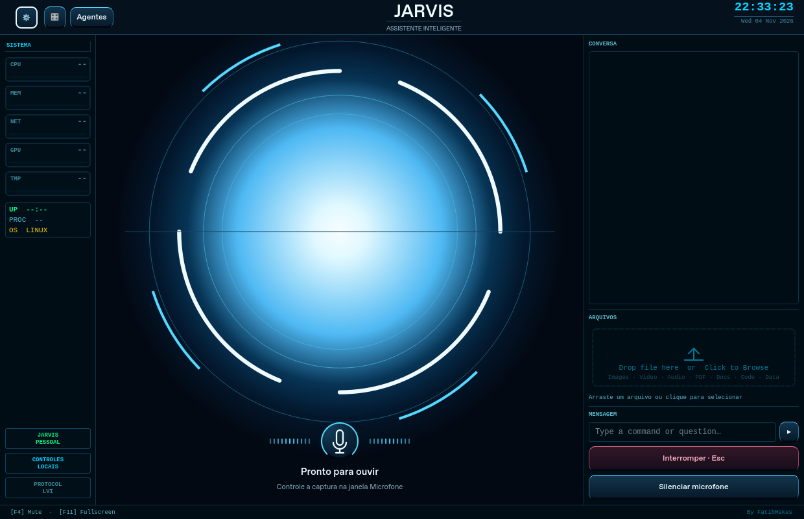

# Interface moderna na janela do main.py

Esta versao atualiza a janela **PyQt6 do proprio Jarvis**, com reator azul LED,
aneis brancos, microfone central e botoes com relevo, foco de teclado, hover e
estado pressionado. O aplicativo principal continua sendo JARVIS. O botao
Agentes abre o gestor de extensoes existente; nenhuma acao operacional do GGO
e adicionada.



O `main.py` da copia preparada recebe uma unica troca de importacao. O novo
modulo instala subclasses visuais em memoria e devolve exatamente a classe
`JarvisUI` original. `ui.py` permanece byte a byte igual, com seus sinais,
callbacks, configuracoes, entrada de texto, arquivos, camera, video, conteudo,
quiz e atalhos. O mudo e a interrupcao continuam chamando os controles antigos.
O avatar pode ser escolhido novamente pelo controle de visual.

O navegador continua responsavel pela captura que ja funcionou no notebook.
Ao conectar, abre uma janela pequena **Microfone do JARVIS**, com Ativar/Parar,
permissao explicita e o mesmo transporte de audio. A interface LED principal
fica dentro da janela nativa. Nao ha QtWebEngine nem nova dependencia de
execucao: PyQt6 ja e usado pelo aplicativo pessoal.

## Instalar na copia ja preparada

Feche a instancia do Jarvis e a janela de microfone. Baixe o ZIP da branch
`codex/interface-nativa-jarvis`, extraia em outra pasta e abra o PowerShell na
pasta que contem `README.md`. Execute:

```powershell
python .\tools\instalar_interface_nativa.py --pasta "$env:USERPROFILE\Desktop\Jarvis-Teste" --atualizar-ponte
```

O instalador usa apenas a biblioteca padrao do Python. Ele verifica o manifesto
da copia, os hashes conhecidos de `main.py` e `ui.py`, a importacao exata e a
sintaxe, sem importar ou iniciar o aplicativo. A ponte e atualizada com backup;
depois um backup local datado preserva o main e o manifesto anteriores. A copia
recebe `jarvis_interface_nativa.py`, a troca de importacao e hashes atualizados.
BOM e finais de linha do main sao preservados. Configuracoes, memoria,
automacoes GGO e a instalacao original nao entram na lista de escrita.

O sucesso mostra **INTERFACE NATIVA INSTALADA OU JA CONFERIDA** e
**NENHUM APLICATIVO EXECUTADO**. Se houver edicoes pessoais, versao diferente,
links/junctions, colisao de modulo ou origem sem preparo, a instalacao e recusada.
Repetir a mesma versao nao reescreve arquivos. Ha backup e rollback de falhas;
feche editores durante a instalacao, pois a verificacao de alteracoes concorrentes
nao equivale a um bloqueio do sistema de arquivos.

Use o iniciador **Jarvis - Interface nova** ja criado no Desktop. Ele chama o
mesmo `main.py`; nao e necessario recriar o iniciador. A janela principal agora
deve mostrar o reator LED e os botoes modernos. A janela Microfone abre quando
o provedor conecta, mantendo as configuracoes de voz ja utilizadas.

## Testar no Windows

1. Confira a nova janela principal, redimensione-a e abra Configuracoes e
   Controles de voz pelos botoes do topo.
2. Na janela pequena Microfone, clique em Ativar microfone, permita o acesso
   e fale uma frase pessoal simples. Confira a resposta de voz.
3. Na janela principal, clique em Silenciar microfone ou no microfone central.
   O controle deve oferecer Reativar microfone e a janela de captura deve
   acompanhar o mudo. Reative e confira outra resposta. F4 permanece disponivel.
4. Teste Interromper/Esc durante uma resposta e uma mensagem simples pelo campo
   de texto. Os callbacks continuam sendo os mesmos do aplicativo anterior.

**Pronto para ouvir** descreve o estado do assistente. A captura efetiva e
confirmada na janela Microfone; abrir o microfone nao ignora wake word ou PTT.
O reator acompanha estados de repouso, processamento, resposta, mudo e conexao,
sem simular operacoes. A animacao reduz a frequencia para 30 FPS, pausa quando
oculta/minimizada e respeita a preferencia de animacoes do Windows. Tambem pode
ser reduzida pela variavel local `JARVIS_REDUCED_MOTION=1`.

Esta verificacao e da interface e voz. A validacao operacional do GGO e da
Etapa 201 continua pendente; nao execute processamento de DUX/Excel neste teste.

## Restaurar a janela anterior

Feche o Jarvis e execute, na pasta da atualizacao baixada:

```powershell
python .\tools\instalar_interface_nativa.py --pasta "$env:USERPROFILE\Desktop\Jarvis-Teste" --restaurar
```

O comando confere os arquivos instalados, cria outro backup, restaura o main
original e remove apenas o modulo visual registrado. Edicoes pessoais nao sao
sobrescritas. A ponte web e as configuracoes atuais sao preservadas. O iniciador
continua apontando para a mesma copia. A pasta original nunca precisa ser escrita.

## Validacao de desenvolvimento

Os testes do instalador usam fontes sinteticas e cobrem backup, linhas/BOM,
repeticao, restauracao, falhas, colisao de importacao, edicoes concorrentes e
compatibilidade com o atualizador web. A interface e testada com Qt real em
`offscreen`, uma facade sintetica e callbacks em memoria: pintura, tamanhos,
botoes, sinais entre threads, troca de avatar e animacoes. Nenhuma chave ou dado
corporativo e usado.

```sh
python -m pip install -r requirements-test-voz.txt -r requirements-test-nativa.txt
python -m unittest discover -s tests -v
QT_QPA_PLATFORM=offscreen python -m unittest discover -s tests-native -v
python tools/preview_interface_nativa.py --captura previa.png
npm test
```

No PowerShell, defina `$env:QT_QPA_PLATFORM="offscreen"` antes do comando de
testes Qt. O preview utiliza somente widgets ficticios, sem importar o Jarvis
privado. A imagem deste documento foi conferida com o codigo visual da base
recebida e configuracao sintetica isolada, sem executar `main.py`, provedores,
GGO ou ler os arquivos pessoais de configuracao. Os fontes privados permanecem
fora do Git. O teste final de dispositivos e voz depende do notebook.
