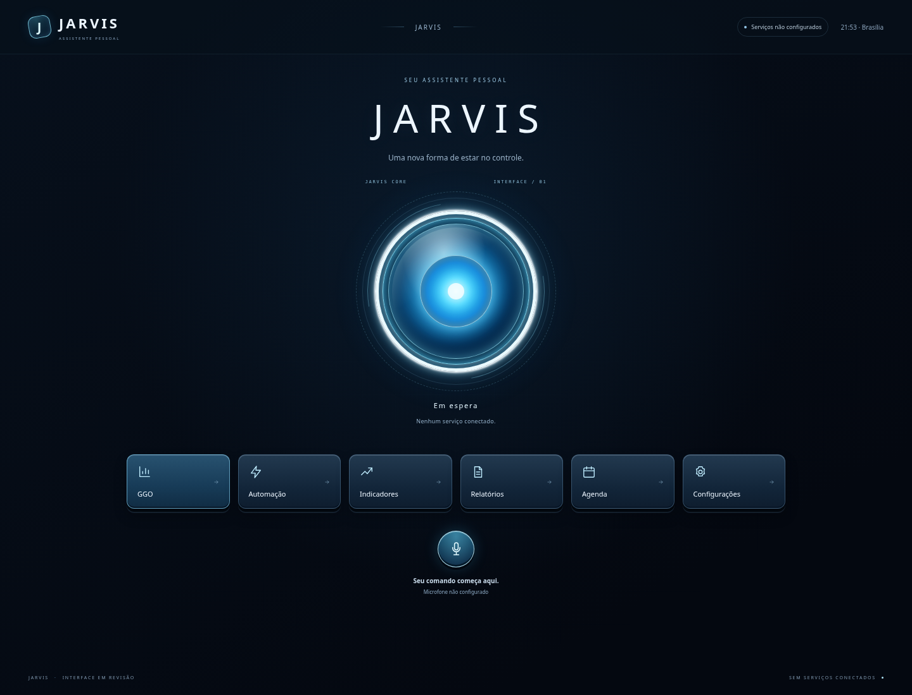
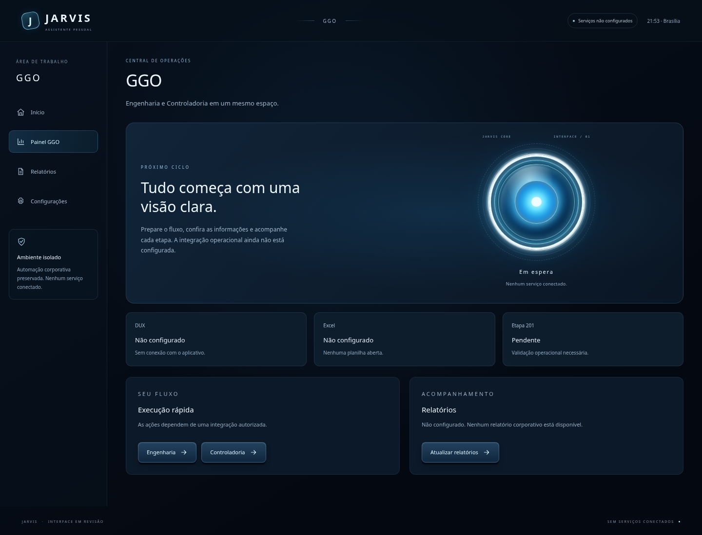

# Interface JARVIS — proposta da issue #5

Nova home e painel GGO preparados em uma camada web isolada, para revisão da
interface oficial. A aplicação do notebook e sua automação não estão disponíveis
neste checkout. Nenhum arquivo da pasta corporativa foi acessado ou alterado.

As duas imagens aprovadas na conversa com ChatGPT não estão anexadas à issue.
Elas foram solicitadas ao usuário. O visual atual segue a descrição textual;
a reprodução fiel das referências continua pendente de recebê-las.



## Arquitetura e preservação

O repositório já tem o protótipo HTML/CSS/JavaScript do PR #3. A nova proposta usa
a mesma stack, sem dependências de execução, em **`interface-oficial/`**. A pasta
`interface/` anterior permanece intacta, assim como os arquivos existentes de
automação, testes Python e workflow GGO.

| Arquivo | Responsabilidade |
| --- | --- |
| `interface-oficial/index.html` | Shell acessível, cabeçalho, conteúdo e diálogo de serviço ausente. |
| `interface-oficial/styles.css` | Tema LED, botões 3D, seis estados visuais, responsividade e redução de movimento. |
| `interface-oficial/core.js` | Rotas permitidas, estados e títulos; funções puras sem DOM ou serviços. |
| `interface-oficial/app.js` | Componentes reutilizáveis de reator, navegação, botões, cartões e telas. |
| `tests-ui/` | Testes unitários e de navegador e servidor estático local de revisão. |

Os componentes são funções de criação de elementos, reutilizadas entre telas.
Conteúdo é atribuído por `textContent`; as rotas e os estados são limitados às
listas do núcleo. Não há framework, build, serviço remoto, armazenamento ou
importação do aplicativo corporativo. O Playwright é somente uma dependência de
desenvolvimento, fixada no lockfile.

## Navegação e estados

A home se chama **JARVIS**, com núcleo azul LED, anel branco, seis botões 3D e
microfone em destaque na parte inferior. Os destinos são `#ggo`, `#automacao`,
`#indicadores`, `#relatorios`, `#agenda` e `#configuracoes`; voltar/avançar do
navegador e links diretos funcionam. Rotas desconhecidas apresentam a home.

O painel GGO tem menu lateral, círculo central, status, execução rápida e
relatórios. DUX/Excel aparecem como **Não configurado**, e a Etapa 201 permanece
pendente. Os botões de operações sem backend abrem um diálogo explicativo;
não iniciam processos, planilhas ou sincronização.



Em Configurações, a **prévia visual** permite selecionar:

| Estado | Apresentação |
| --- | --- |
| Em espera | Pulsação azul suave. |
| Ouvindo | Pulso e anel de escuta; microfone continua desligado. |
| Processando | Rotação e ritmo distintos, sem execução operacional. |
| Respondendo | Variação do brilho, sem síntese ou reprodução de voz. |
| Erro | Núcleo/anel em vermelho e rótulo explícito. |
| Desconectado | Brilho reduzido, sem animação contínua. |

Esses estados são uma demonstração de apresentação, sem inferir estado real.
O botão de microfone abre Configurações e não chama captura de áudio nem
reconhecimento de voz. Os serviços continuam identificados como não configurados.

Animações usam CSS, respeitam `prefers-reduced-motion` e pausam quando a aba fica
oculta. O relógio atualiza uma vez por minuto em `America/Sao_Paulo`. Foram
verificados teclado, foco, atalho de conteúdo, Escape, rótulos e layout móvel;
isso não constitui auditoria completa de conformidade de acessibilidade.

## Instalação e revisão local

Use uma cópia de desenvolvimento separada da pasta original. Requisitos para os
comandos abaixo: **Node.js 22+** e npm. Na raiz da branch:

```sh
npm ci --ignore-scripts
npm run serve
```

O servidor estático escuta apenas a interface local na porta 8790 e serve somente
`interface-oficial/`. Não implementa endpoints de automação. Esta pasta pode ser
servida por outro servidor estático autorizado; módulos ES exigem HTTP, portanto
a abertura direta por `file://` não é o modo suportado.

O aplicativo não precisa de pacotes de runtime. A instalação npm acima prepara
as ferramentas de teste; não baixa ou executa código corporativo.

## Testes

```sh
npx playwright install chromium
npm test
```

`npm test` executa 5 testes unitários de rotas/estados e 12 testes de navegador:
home, seis destinos, hash/voltar/avançar, fallback, teclado/foco, atalho de conteúdo,
seis estados, microfone sem áudio, serviços ausentes, mobile, movimento reduzido
e funcionamento sem rede após o carregamento. Cada caso de navegador confere
ausência de erros JavaScript e requisições externas.
O teste responsivo percorre todas as telas em 320, 360, 390 e 768 pixels, incluindo
o halo luminoso; nenhuma dessas resoluções deve ter rolagem horizontal da página.

Quando houver um Chromium já instalado e autorizado, indique seu executável em
`JARVIS_CHROMIUM` para evitar um download adicional. A CI instala seu Chromium
com o instalador oficial do Playwright e executa os mesmos testes em Linux. O
workflow tem somente permissão de leitura e não faz implantação.

O teste estrutural Python existente continua disponível e separado:

```sh
python -m unittest discover -s tests -v
```

## Rollback e pendências

Encerre o servidor com `Ctrl+C` e volte ao protótipo anterior em `interface/`.
Nenhuma migração, escrita em produção ou alteração da pasta original precisa ser
desfeita. O PR é separado e empilhado sobre o PR #3; abandonar a nova pasta/branch
de revisão não modifica aquela interface.

Pendências: receber as duas referências para ajuste visual fiel, revisar o layout
e definir contratos autorizados para voz e demais serviços. Conectar DUX, Excel,
GGO, microfone ou sincronização é trabalho futuro e não está habilitado nesta UI.
