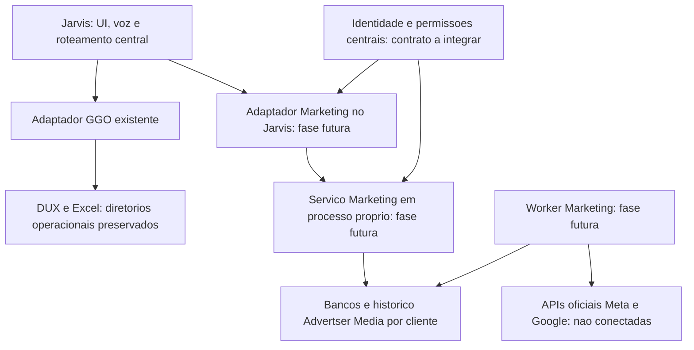

# Arquitetura paralela — ADVERTSER MEDIA

Nome de produto: **ADVERTSER MEDIA — MARKETING INTELLIGENCE**.
Identificador tecnico: `advertser_media`.
Agente futuro: **JARVIS MARKETING INTELLIGENCE**.

## Fronteiras



O desenho e a arquitetura alvo. A primeira entrega implementa somente a
biblioteca local e seu armazenamento, nao os processos/servicos desse diagrama.

- O GGO continua com seus arquivos, configuracoes, interfaces e ciclo proprio.
- O Marketing tem pacote, dependencia, namespace de dados, migracoes e operacao
  proprios. Nao importa o main, modulos DUX/Excel, voz, UI ou memoria do GGO.
- O adaptador do nucleo faz chamadas com timeout, controle de falhas e identidade
  verificada. Uma indisponibilidade de Marketing deve degradar somente seu
  painel. Nenhuma excecao do worker pode encerrar o nucleo ou o GGO.
- Nao ha leitura direta de banco entre modulos. Memoria/historico de Marketing
  usam namespace do modulo e do cliente; nao leem memorias privadas existentes.

## Dados, identidade e permissoes

A fundacao inicial usa somente a biblioteca padrao do Python, incluindo SQLite.
O host fornece explicitamente `data_root`, UUIDs autorizados e diretorios
protegidos. O caminho e derivado internamente:

```text
<data_root>/advertser_media/
  .advertser-media-runtime.json
  clients/<UUID>/marketing.sqlite3
```

O cliente de interface nunca escolhe caminhos de banco. O host deve fornecer os
diretorios operacionais GGO como `protected_roots`; o modulo nao os descobre
inspecionando configuracoes privadas. Links/junctions, sobreposicao, banco de
outro cliente, arquivo desconhecido e schema/identidade incompatibilizados sao
recusados. Leituras sem registro nao criam bancos. O namespace nao se reaproveita
de um banco Jarvis/GGO existente.

`IdentityVerifier` e uma interface para o futuro verificador central, nao um
login local. Sem esse verificador, o servico recusa operacoes protegidas. Um
header com `role=admin`, um UUID, uma fala do usuario ou uma instancia de
Principal recebida do navegador nao constituem autenticacao. A API futura deve
validar assinatura, emissor, audiencia, expiracao e revogacao antes de produzir a
identidade confiavel. Nenhum verificador de teste sera habilitado por configuracao
de producao.

Nesta entrega: viewer consulta perfis; manager e admin consultam/atualizam e
leem auditoria. Todas as funcoes, inclusive admin, precisam de acesso explicito
ao cliente e de cliente previamente autorizado na configuracao do modulo.
Permissoes de conteudo, aprovacao, financeiro e plataformas serao acrescentadas
por recurso. O perfil local inclui contrato/mensalidade basicos; isso nao
implementa contas a receber, cobranças nem uma politica financeira completa.

Criar/atualizar perfil e inserir seu evento de auditoria ocorrem na mesma
transacao. Auditoria contem identificadores, ator, acao e data, nunca credencial
nem o perfil inteiro. Leituras/negacoes terao rastreio no gateway futuro; ainda
nao ha esse gateway. SQLite nao e armazenamento fisicamente imutavel ou
criptografado. ACLs, backups protegidos, criptografia de disco, retencao,
exportacao/exclusao, base legal e responsabilidades LGPD precisam ser definidos
antes de dados reais. A aplicacao nao isola codigo malicioso com os mesmos
privilegios do usuario do sistema operacional.

## Conectores oficiais de anuncios

Fase inicial de conectores: somente leitura, sem metodos de alteracao no adapter.
Versoes suportadas, escopos e validacao dos aplicativos precisam ser conferidos
na documentacao oficial antes da conexao real.

| Plataforma | Preparacao necessaria | Limite do primeiro conector |
| --- | --- | --- |
| Meta Ads | Aplicativo aprovado, consentimento, contas autorizadas e permissoes de leitura validadas, tokens em cofre. | Consultar contas, campanhas e Insights autorizados; paginacao, limites, expiracao e revogacao tratados. |
| Google Ads | Developer token, cliente OAuth, usuario autorizado, customer id e manager id quando aplicavel. | Somente operacoes de consulta permitidas, como Search/SearchStream; nenhum Mutate. |

O escopo OAuth de Google Ads nao e intrinsecamente somente leitura. O conector
precisa de allowlist de operacoes e, quando possivel, acesso adequado de conta.
Solicitar escopos de escrita so quando uma funcao concreta aprovada os exigir.
Segredos serao referencias de cofre/armazenamento seguro; nao irao para SQLite,
Git, logs, memorias do agente ou o arquivo de chaves pessoal do Jarvis.

## Metricas e respostas fundamentadas

Todo snapshot devera identificar cliente, plataforma, conta, periodo, fuso,
moeda, instante de coleta e origem. Ausencia, atraso, erro e indisponibilidade
sao estados distintos. `null` significa dado ausente; zero so representa uma
medida explicitamente recebida como zero. A primeira entrega nao gera snapshots
nem metricas ficticias no status.

- Valores monetarios usam Decimal/unidades oficiais; `cost_micros` deve ser
  normalizado explicitamente. Nao se somam moedas distintas sem conversao
  validada com taxa e data registradas.
- CPC, CPM, CTR, CPL e CPA consolidados sao recalculados a partir dos totais
  compativeis; nao pela media simples de taxas. Denominador zero resulta em
  indisponibilidade, nao numero inventado.
- Alcance e outras medidas nao aditivas nao sao somados entre periodos ou
  plataformas como se representassem pessoas unicas.
- ROAS exige receita atribuida confiavel, janela de atribuicao e moeda
  compativeis. ROI exige custos/resultado apropriados; nao e sinonimo de ROAS.
- O agente futuro recebe somente dados ja filtrados por identidade/cliente,
  aponta fontes e desatualizacao e separa fatos de recomendacoes. Conteudo de
  anuncios/documentos e dado de entrada, nunca instrucao para executar ferramentas.

## Conteudo e aprovacao humana

Calendarios, ideias, legendas, roteiros e criativos terao revisoes por cliente.
Uma aprovacao devera vincular ator, cliente, conta/canal, acao, revisao/hash do
payload, expiracao e resultado. Editar o conteudo invalida a aprovacao anterior.
Uma autorizacao previa deve ser especifica, registrada, limitada e revogavel.

Registrar aprovacao nao equivale a executar. Publicacao, orcamento, pausa e
alteracao de anuncios precisarao de executor separado, operacao permitida,
consentimento vigente, verificacao da aprovacao e idempotencia. A primeira
entrega nao tem aprovador, agendador nem executor externo.

## Interface e execucao continua

O acesso devera entrar em Agentes sem substituir a home LED. Marketing tera
painel proprio dentro do Jarvis, preservando a navegacao GGO. O adaptador Qt e a
futura interface responsiva para mobile devem consumir os mesmos contratos do
servico, com falhas e autenticacao explicitas. A integracao depende do contrato
real de extensoes privado; nenhum arquivo novo sera servido pela ponte de voz
por acaso. A escolha do renderer/dependencias de Marketing pertence a fase 3.

Workers serao processos independentes da GUI, com fila/agenda, leases,
idempotencia por cliente/conta/periodo, retries limitados, backoff, monitoramento,
backup e recuperacao. Agenda, alertas e resumo diario nao significam servico
24 horas instalado. Hospedagem, identidade, segredos, restart e operacao precisam
ser provisionados e validados. O notebook corporativo nao e pressuposto como
servidor permanente.
